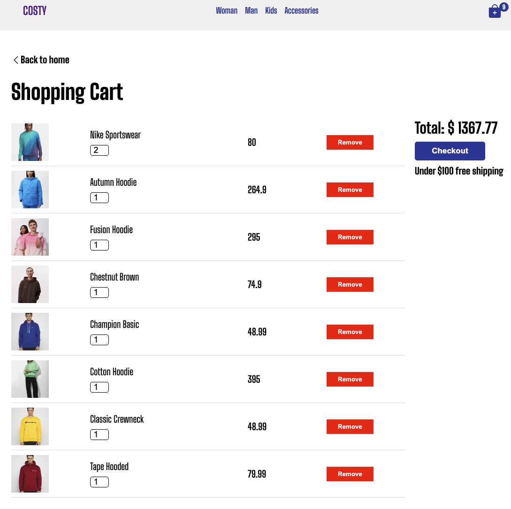
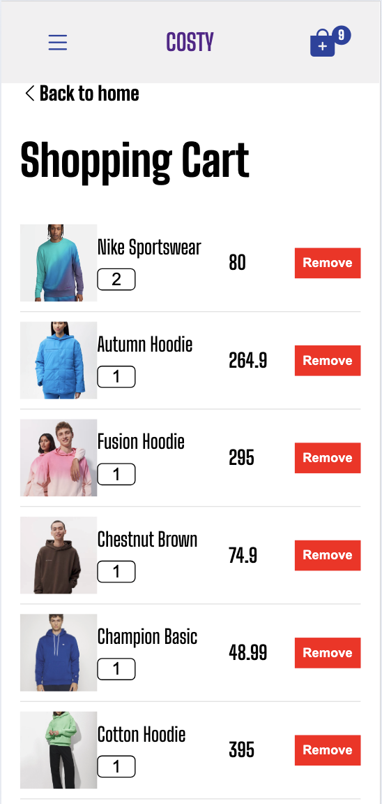

# COSTY — E-Commerce Frontend

A responsive fashion storefront built with HTML, SCSS, and vanilla JavaScript. Browse products, manage your shopping cart, and keep your cart saved between visits.

Developed by **Hasan Koparan** during the **Udemig full-stack training program**.

## Screenshots

### Storefront


### Desktop Shopping Cart



### Mobile Shopping Cart



## Features

- Responsive layouts for desktop and mobile screens.
- Collapsible mobile navigation.
- Dynamic product listing using the Fetch API and local JSON data.
- Add products to the cart.
- Increase the quantity of products already in the cart.
- Update product quantities from the cart page.
- Remove products after confirmation.
- Save and restore the cart using localStorage.
- Display the total number of units in the cart badge.
- Calculate the order total from product prices and quantities.
- Apply a $50 shipping fee to positive subtotals below $100.
- Display an empty-cart message when all products are removed.

## Technologies

| Technology      | Purpose                                 |
| --------------- | --------------------------------------- |
| HTML5           | Page structure                          |
| SCSS / CSS3     | Styling and responsive layouts          |
| JavaScript      | Product rendering and cart interactions |
| ES Modules      | Organizing JavaScript across files      |
| Fetch API       | Loading product data                    |
| localStorage    | Cart persistence                        |
| Bootstrap Icons | Navigation and shopping icons           |

## Getting Started

Clone the repository:

```bash
git clone https://github.com/HasanKoparan/e-commerce.git
cd e-commerce
```

Open the project in VS Code. With the **Live Server** extension installed, right-click `index.html` and select **Open with Live Server**.

Run the project through a local HTTP server so JavaScript modules and product data load correctly.

### Editing Styles

Compiled CSS is included in the repository.

To automatically compile SCSS while editing, install Node.js and run this command from the project root:

```bash
npx sass styles/styles.scss styles/styles.css --watch
```

## Project Structure

```text
e-commerce/
├── assets/
│   └── home.png
├── js/
│   ├── api.js
│   ├── cart.js
│   ├── helper.js
│   ├── main.js
│   └── ui.js
├── screenshots/
│   ├── home-desktop.png
│   ├── cart-desktop.png
│   └── cart-mobile.png
├── styles/
│   ├── _cart.scss
│   ├── _footer.scss
│   ├── _header.scss
│   ├── _home.scss
│   ├── _products.scss
│   ├── _responsive.scss
│   ├── _variables.scss
│   ├── styles.scss
│   ├── styles.css
│   └── styles.css.map
├── cart.html
├── db.json
├── index.html
└── README.md
```

## How the Cart Works

1. Product data is loaded from `db.json`.
2. Adding a product creates a cart entry or increases its quantity.
3. The updated cart is saved in localStorage.
4. The cart page restores saved products and renders their quantities.
5. Quantity changes and removals update the cart badge and order total.

## Learning Focus

- Responsive design with SCSS partials and media queries.
- JavaScript modules with `import` and `export`.
- Array methods including `map`, `find`, `filter`, and `reduce`.
- DOM manipulation and event handling.
- Asynchronous data loading with the Fetch API.
- JSON conversion and browser storage.
- Synchronizing saved cart data with the interface.

## Author

**Hasan Koparan**

[GitHub Profile](https://github.com/HasanKoparan) · [Project Repository](https://github.com/HasanKoparan/e-commerce)

## Credits

Developed as a learning project during Udemig training.

Product and promotional imagery belong to their respective owners and are used to demonstrate the storefront interface.
